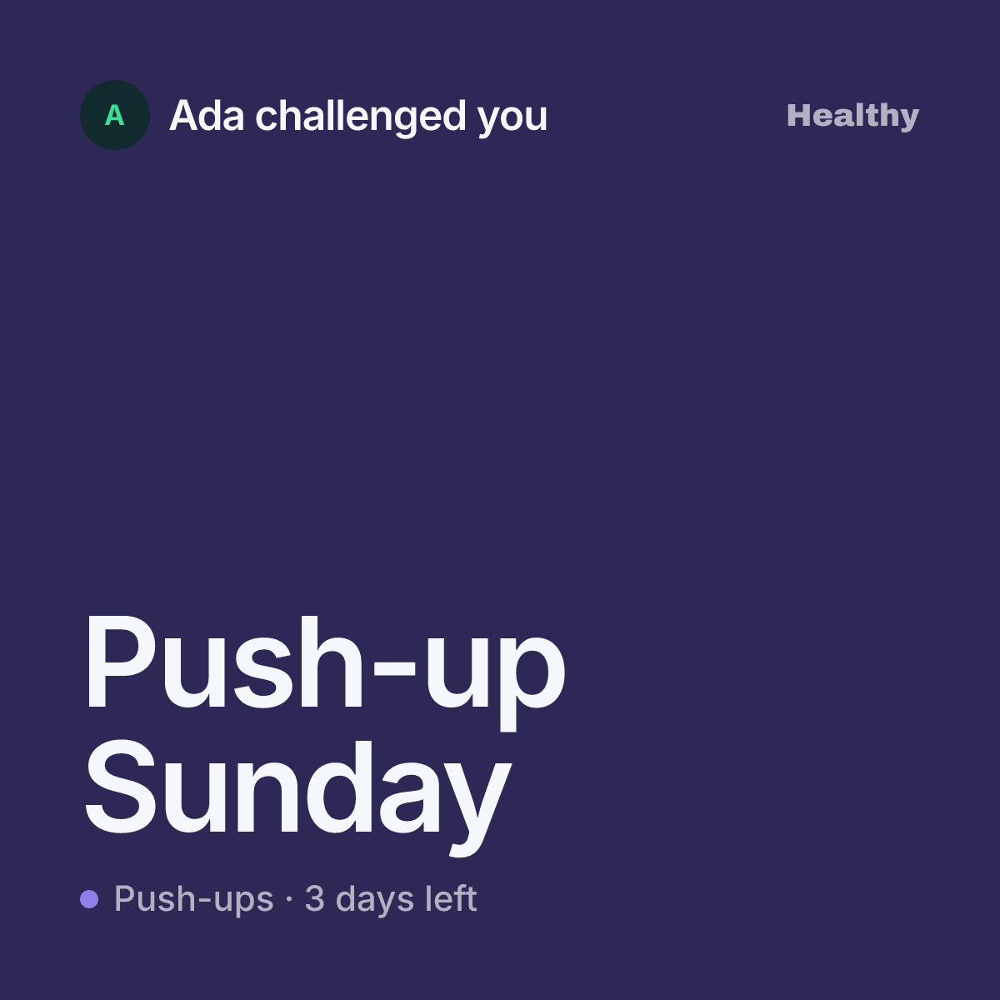
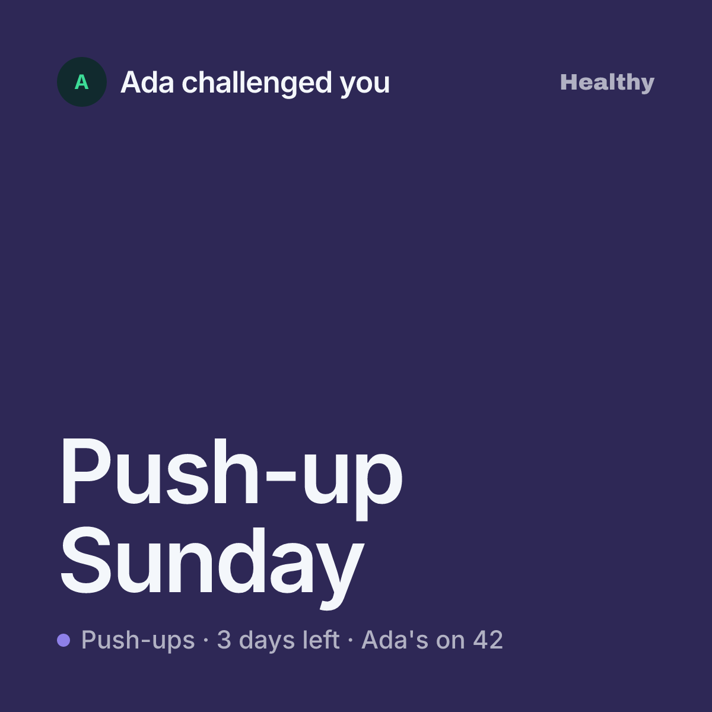
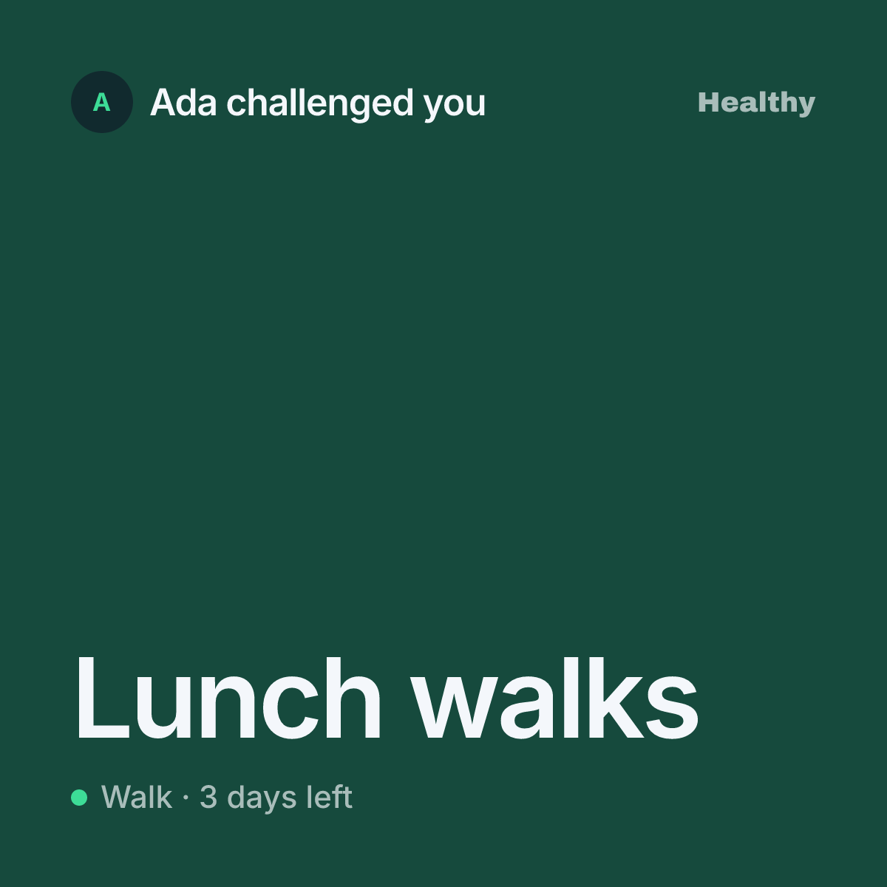
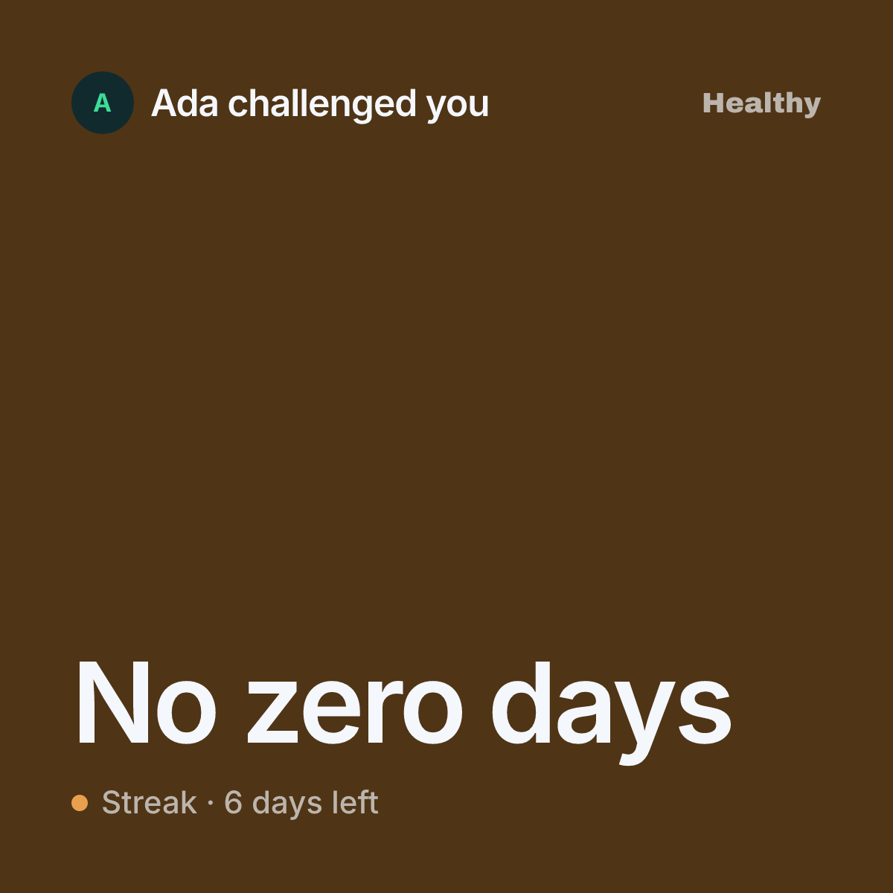
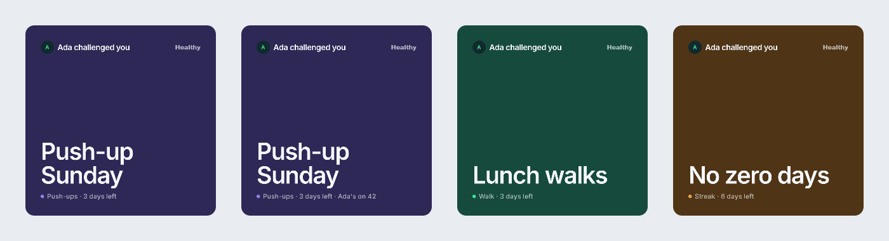

# Invite link preview

The image a friend sees when a member shares a contest invite. The app shares
text plus `https://www.gethealthyapp.com/match/<token>`; WhatsApp, iMessage,
Telegram and Slack then fetch the page's Open Graph image. That image is drawn
on demand by
[`apps/website/src/pages/match/[token]/og.png.ts`](../apps/website/src/pages/match/[token]/og.png.ts).

It is the first thing most new members ever see of Healthy, so it is a product
surface, not a meta tag. It follows [`design-direction.md`](design-direction.md).

## Why it is being redesigned

- It predates the October overhaul: its own navy-to-green gradient, Inter from
  a CDN, "HEALTHY" as small grey caps — it matches neither the old nor the new
  look.
- It leads with the host's score. A host can create and share a contest before
  doing a single rep, so the score is often missing or zero.
- Its headline repeats the sentence chat apps already print under the image.
- A "Tap to join" pill looks like a button but is part of the picture.
- The CDN font fetch on cold renders means a slow CDN gives no preview at all.

## Spec

**Job.** In a chat thread, in about a second: *a friend invited you into a
contest.* The whole image is one card — the card the friend will find in their
Today deck once they join — not a card placed on a background.

It carries only who, what and when. The rule, the roster and the seats are one
tap away on the join screen, so the card does not repeat them.

### Content

1. **Who** — top left: the host's first name and photo (initials when there is
   none): "Ada challenged you".
2. **Brand** — top right: the Archivo wordmark, quiet. No band: the chat app
   already prints the URL under the image.
3. **What** — bottom left, the largest type: the contest title.
4. **Activity and when** — under the title, after a dot in the activity colour:
   "Push-ups · 3 days left".
5. **The host's score, only when they have one** — appended to that line:
   "· Ada's on 42". Never larger than the line it sits on.

### States

| State | What changes |
|---|---|
| Host has not scored (the common case) | Line reads "Push-ups · 3 days left" |
| Host has scored | Line adds "· Ada's on 42" |
| Activity | Card colour follows the activity: purple strength, green walk, amber streak contests |
| No profile photo | Initials on the tinted disc, as in the app |
| Long title | Two lines at most, then truncated |
| Contest ended or cancelled | Line reads "Ended" |
| Preview data unavailable | Generic branded invite |

### Constraints

- **Square, 1200×1200, filled edge to edge with the activity's night card
  colour.** A square keeps its shape wherever it lands; a wide 1200×630 image
  is shown as a rectangle by iMessage and WhatsApp's large preview. Chat apps
  round the corners themselves. Set `og:image:width` and `og:image:height` to
  match.
- **Trade-off:** some apps show a square preview smaller than a wide one —
  WhatsApp tends to use a compact thumbnail beside the text. Check on device
  in WhatsApp and iMessage before shipping.
- **Healthy night**, as for every exported image.
- **Small file.** Flat colour; the only raster image is the host photo.
- **Satori renderer.** Flexbox, solid fills, rounded corners, borders (dashed
  included), simple shadows, embedded PNG/JPEG, bundled fonts. No blend modes,
  filters, blur, or CSS grid.
- **Fonts bundled with the website:** Inter for the system-sans text, Archivo
  Black for the wordmark.
- **No button shapes.** The whole preview is already the tap target.
- **First names only.** Never a surname, handle, or the rest of the roster.

### Data

Available today from the public invite preview: host first name, metric,
scoring mode, host score, status, end time.

Needs a small contract and API addition before build: **contest title** and
**host photo URL**. Both are shown to anyone holding the link; the title is
host-written text, so it stays plain text and is never the hero.

## Chosen direction: the invite card

Rendered with Satori at the real size, so it is buildable as drawn. Sources in
[`invite-preview/`](invite-preview/).

The person and the wordmark on top; the contest title and one line of activity
and time at the foot, as a deck card holds its title.

Host has scored — the score joins the small line, nowhere bigger:

The card takes the activity's colour:

At thumbnail size:

## Designer brief

> **Healthy invite link preview, 1200×1200 square**
>
> When a member shares a contest invite, this image is what their friend sees in
> WhatsApp or iMessage. It should say "Ada invited you into Push-up Sunday" in
> about a second. The whole image is one card in the activity's colour — the
> card the friend will find in their Today deck after joining — with no footer
> band. Follow `docs/design-direction.md`: Healthy night, activity colours,
> system-sans titles. No leaf.
>
> Keep it to who, what and when; the join screen carries the rule, roster and
> seats. The direction is mocked above. Please refine the type scale, spacing,
> and how the wordmark sits. The host's score is optional and secondary — most
> invites are sent before the host has done anything.
>
> Show: host not scored, host scored, a walk contest, a streak contest, a photo,
> no photo, a long title, and ended. Mock it inside a WhatsApp thread and an
> iMessage bubble, at the size each app actually shows a square preview, not
> only as a flat frame.
>
> Constraints: flexbox-buildable (Satori), Inter and Archivo Black only, no
> button shapes, first names only.

## Build

1. Add `title` and `hostImage` to the public invite preview contract and API.
2. Bundle Inter and Archivo Black with the website; drop the CDN fetch.
3. Rebuild `og.png.ts` as the square invite card, with the states above, and
   update the page's `og:image` size tags. The website
   is a standalone deploy with vendored brand tokens, so the night activity
   colours are copied in alongside them, not imported from `@product/brand`. A
   photo that fails to load falls back to the initials disc instead of failing
   the image.
4. Unit-test the text helpers (the activity-and-time line, truncation).
